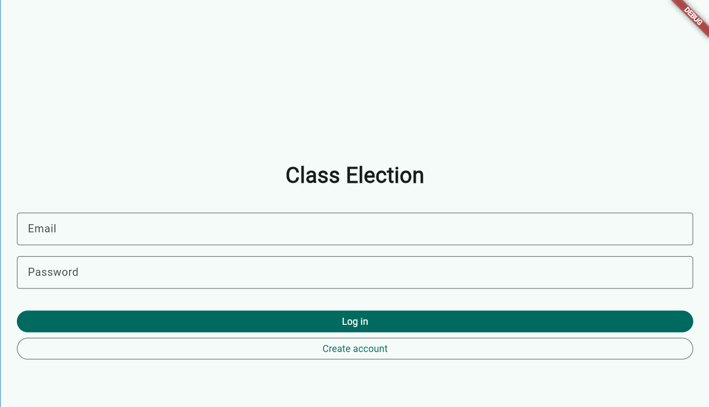
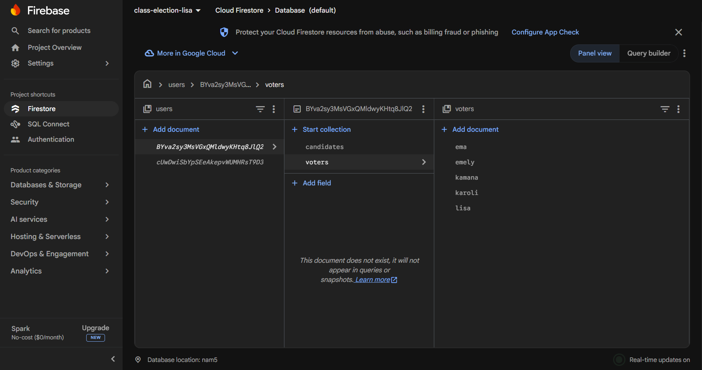
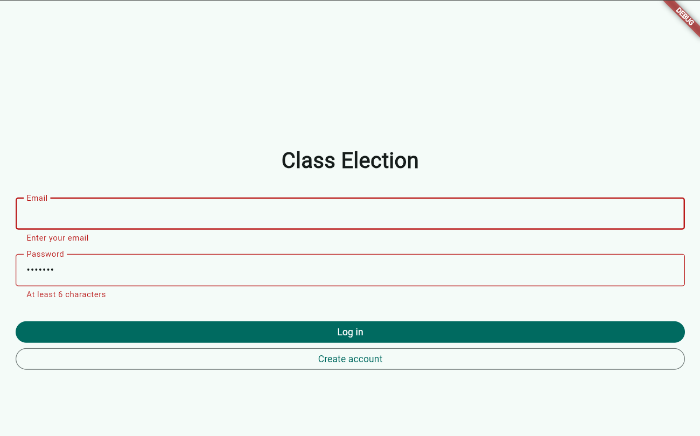
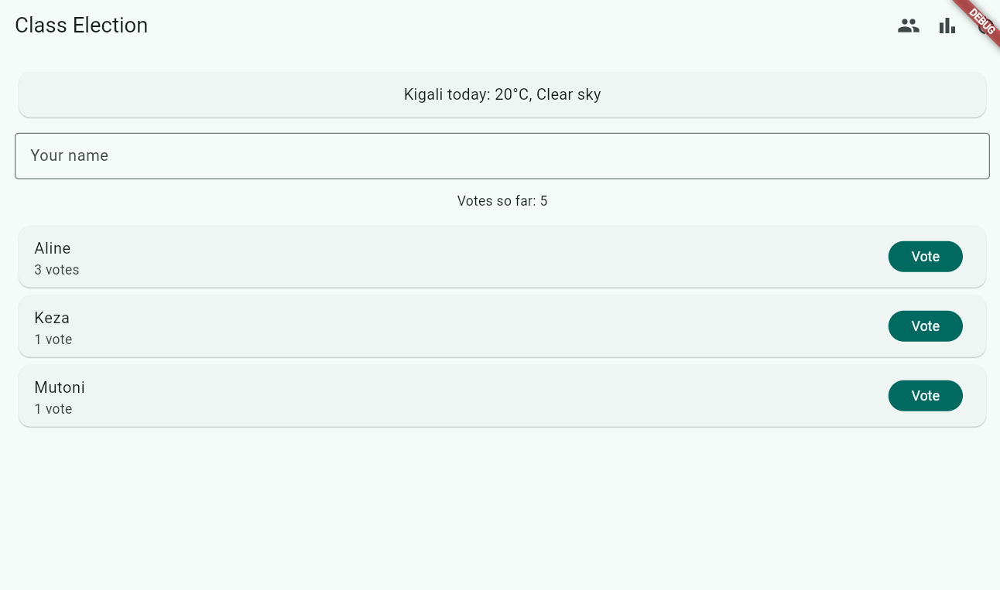

# Class Election

A class voting app: students vote for candidates, and the results show the percentages, the ranking and the winner or a tie.

## Session 6: Firebase

My data now lives in the cloud. People create an account and log in with Firebase Authentication, and the candidates and votes are saved in Cloud Firestore under `users/{id}/`, so each account only sees its own election. The screens update live, and I can add, edit and delete candidates. The rules make sure nobody can read another user's data.

Earlier, my data was saved with shared_preferences (in the browser, because I ran the app in Chrome), so nothing was lost when I closed and reopened the app. The app also shows today's weather in Kigali from the Open-Meteo API. Firestore has now replaced shared_preferences for the main data.

