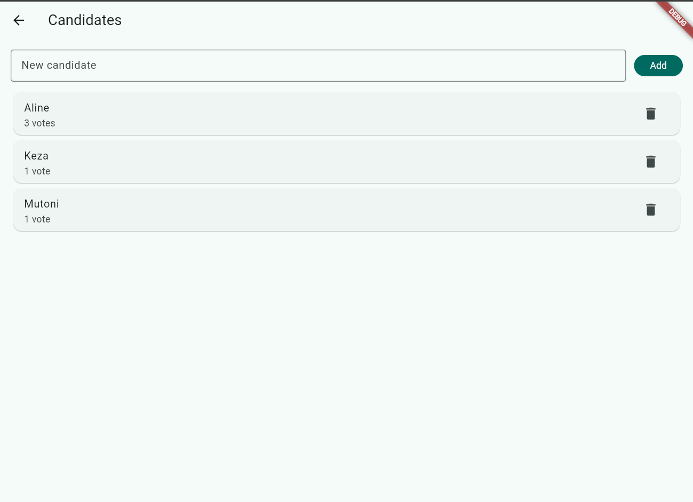
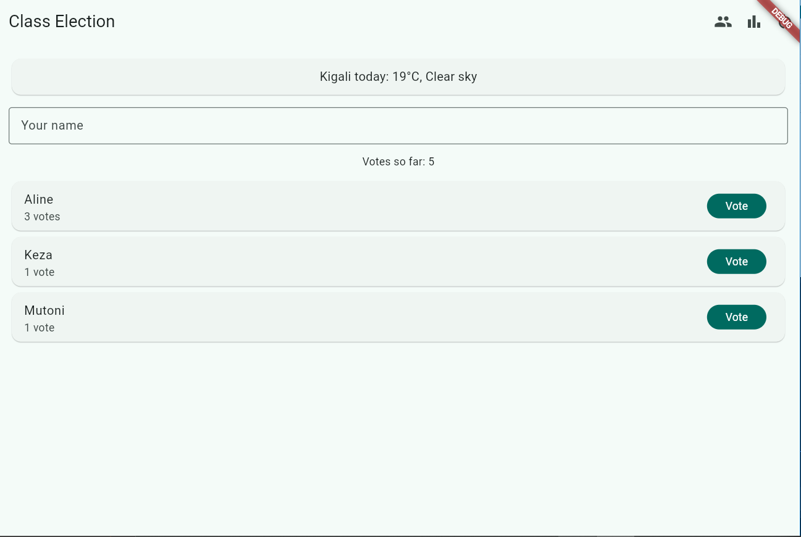
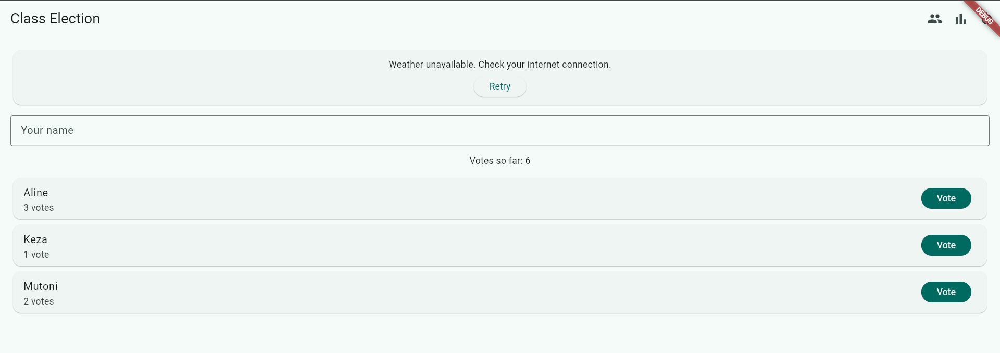

# Class Election

A class voting app where students vote for candidates and see ranked results. My data is now saved on the phone with shared_preferences, so nothing is lost when the app closes, and it shows today's weather in Kigali from the Open-Meteo API.

## Screenshots
1. Before Closing the App

This screenshot shows the registered candidates and their current vote counts before closing the app.

2. After Running Again

This screenshot demonstrates that candidate information and votes remain saved after reopening the app.

3. Live Data from an API

This screenshot shows Kigali's weather retrieved from the Open-Meteo API.

4. No Internet Connection

This screenshot demonstrates how the app handles a weather request when there is no internet connection.

